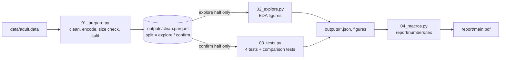

# C5XW20: does the gender gap in high income survive matching on job and education?

Midterm project for CSE558 Data Science (IIIT Delhi, Monsoon 2026), group **C5XW20**.
We test four pre-registered hypotheses on the 1994 US census "Adult" data and report effect sizes,
not only p-values.

**Report:** [`report/main.pdf`](report/main.pdf) (5 pages). **Pre-registration:** [`PREREGISTRATION.md`](PREREGISTRATION.md).

## Quick start (about 5 minutes)

You need [`uv`](https://docs.astral.sh/uv/) and an internet connection for the first run.
`latexmk` is optional and only needed to rebuild the PDF.

```bash
git clone https://github.com/durgesh-k-sharma/c5xw20-midterm
cd c5xw20-midterm
bash run_all.sh            # about 55 seconds in total
```

Check that it worked:

```bash
python3 -c "import json; t=json.load(open('outputs/test_results.json')); print(round(t['t1']['or_mh'], 3))"
# expected: 0.253
```

If anything fails, see [`docs/RUNBOOK.md`](docs/RUNBOOK.md).

## Results at a glance

All tests use the confirmation half (16,269 people). Significance level 0.05, Holm correction over four tests.

| # | Question | Estimate (95% CI) | Line that matters | Holm p | Verdict |
|---|---|---|---|---|---|
| 1 (primary) | Do women have lower odds of income above 50K within the same occupation and education band? | odds ratio 0.253 (0.227 to 0.283) | 0.80 | 2.7e-142 | matters |
| 2 | Is the sex gap in weekly hours different for married and never-married people? | 3.79 h (2.70 to 4.88) | 2 h | 1.2e-11 | matters |
| 3 | Do people with a capital gain work different hours? | Hodges-Lehmann 0.0 h (0.0 to 0.0); mean gap 3.00 h (2.34 to 3.65) | 2 h | 1.8e-27 | depends on the estimate |
| 4 | Is income independent of employer type? | Cramér's V 0.172 (0.154 to 0.190) | 0.10 | 4.7e-94 | matters |

Two results need care:
- **Test 1** is an association, not proof of unequal pay. We did not match on age, hours or industry.
- **Test 3** has about 41% to 47% of both groups at exactly 40 hours, so the median shift is 0 while the means differ by 3 hours. We report both.

## How it works



Every number in the PDF is written by `04_macros.py` from the JSON files. No number is typed by hand.

## Repository map

| Path | What it is |
|---|---|
| `PREREGISTRATION.md` | Hypotheses, tests, thresholds and split, committed **before** any script. Do not edit. |
| `data/adult.data` | Raw file as downloaded (3.9 MB). |
| `src/common.py` | Seed (558), paths, column lists, education bands. The only place for shared settings. |
| `src/01_prepare.py` | Names, `?` to `Unknown`, drop 24 duplicates, one-hot encode, size check, 50/50 split. |
| `src/02_explore.py` | EDA on the exploration half only. Writes 4 figures and `explore_stats.json`. |
| `src/03_tests.py` | The four tests on the confirmation half, with comparison tests. Writes `test_results.json` and the forest figure. |
| `src/04_macros.py` | Turns the JSON files into `report/numbers.tex`. |
| `run_all.sh` | Runs steps 1 to 4 and builds the PDF. |
| `outputs/` | `clean.parquet`, `encoded_features.parquet`, `data_dictionary.csv`, three JSON result files, run logs, figures. |
| `report/` | LaTeX source (`preamble.tex`, `body.tex`, joined into `main.tex`) and `main.pdf`. |
| `docs/RUNBOOK.md` | How to reproduce, check and fix a run. |
| `docs/DECISIONS.md` | Every choice, the alternatives, and the reason. |

## Where to find each course requirement

| Requirement | Where |
|---|---|
| Source, rows, columns, size check (3M) | Report Section 1; `outputs/prep_stats.json` |
| Data dictionary | `outputs/data_dictionary.csv` |
| Preparation and reasons | Report Section 2; [`docs/DECISIONS.md`](docs/DECISIONS.md) |
| Before and after numbers | Report Section 3; `outputs/prep_stats.json` |
| Basic questions, EDA, problem statements | Report Section 4; `outputs/explore_stats.json` |
| 3 to 5 hypothesis tests | Report Section 5; `outputs/test_results.json` |
| Code and README | this repository |

## Key numbers

| Item | Value |
|---|---|
| Rows, raw / after removing duplicates | 32,561 / 32,537 |
| Columns, raw / after one-hot encoding | 15 / 108 |
| Size check | 32,537 × 108 = 3,513,996 (needs 3,000,000) |
| Split | 16,268 exploration / 16,269 confirmation, seed 558, stratified on income |
| Share above 50K in each half | 24.09% / 24.09% |

## Reproducibility

- Python 3.12 or newer. Versions are pinned in `uv.lock`.
- One seed (558) in `src/common.py` drives every random step: the split, the shuffles and the bootstraps.
- On the machine where we built this, a second full run gave byte-identical JSON files. On another machine, expect the same numbers to the precision shown in the report. Library differences could change digits far past that.
- Step 3 records the pre-registration commit in `test_results.json`, so the report can cite it.

## Contributing

1. Do not edit `PREREGISTRATION.md`. If a test must change, add an entry to the deviations list in [`docs/DECISIONS.md`](docs/DECISIONS.md) and say why.
2. `02_explore.py` must never read the confirmation half. `03_tests.py` is the only script that does.
3. After any code change, run `bash run_all.sh` and commit the scripts and the regenerated `outputs/` and `report/` together.
4. Do not rewrite git history after publishing. The report cites commit `90cb66a`, the first commit. Check with `git log --reverse --format=%h | head -1`.
5. Keep new documents short, in plain English, and link to other documents instead of copying them.

## Data and citation

- Data: Kaggle `mlbysoham/adult-dataset`, which is the training file of the UCI Adult (Census Income) data.
  Becker, B. and Kohavi, R. (1996). Adult. UCI Machine Learning Repository, https://archive.ics.uci.edu/dataset/2/adult. License CC BY 4.0.
- Kohavi, R. (1996). Scaling up the accuracy of naive-Bayes classifiers: a decision-tree hybrid. KDD-96.

## Team

Aryan Bundela (2023141), Durgesh Kumar Sharma (2023214), Shourya Sharma (2020129), Arpit Dabas (2023131).
